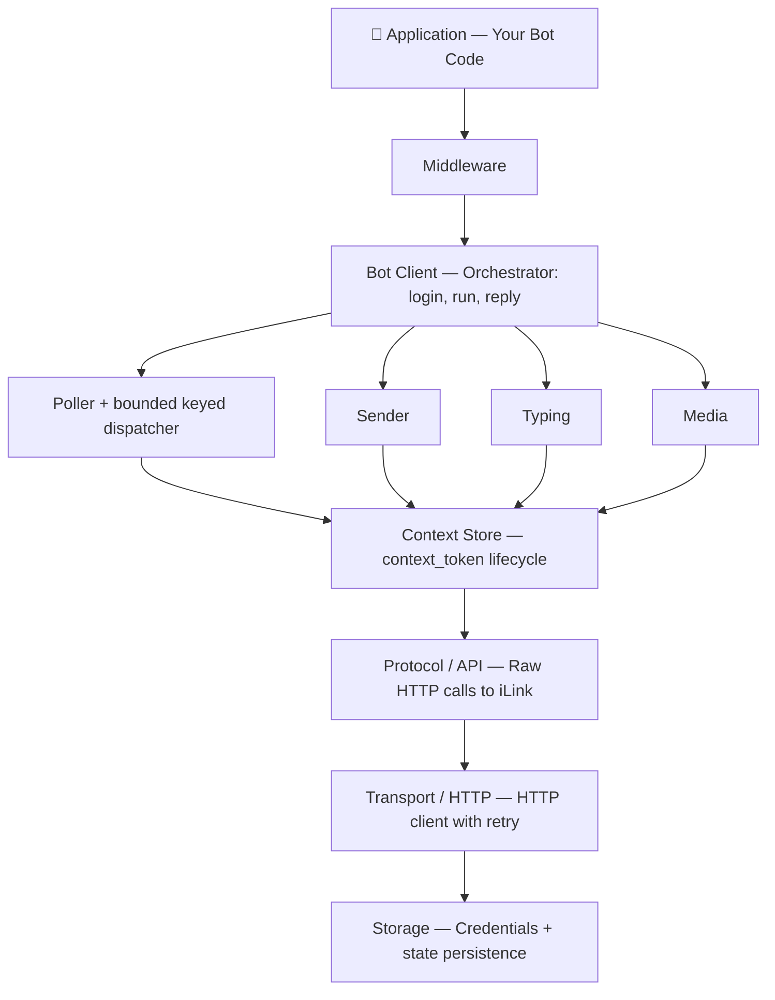

# Architecture

All four SDKs (Node.js, Python, Go, Rust) follow the same layered architecture and expose a consistent API surface.

## Layers



## SDK Comparison

| Feature | Node.js | Python | Go | Rust |
|---|---|---|---|---|
| Package | `@wechatbot/wechatbot` | `wechatbot-sdk` (PyPI) | `github.com/Icatme/wechatbot-go` | `wechatbot` (crates.io) |
| Async model | `async/await` (Promises) | `async/await` (asyncio) | goroutines + `context.Context` | `async/await` (tokio) |
| Middleware | ✓ Express-style pipeline | — (use decorator composition) | ✓ handler composition | — (use closures) |
| Storage | Pluggable (file/memory/custom) | File-based | File-based | File-based |
| Media crypto | ✓ AES-128-ECB | ✓ AES-128-ECB | ✓ AES-128-ECB | ✓ AES-128-ECB |
| Events | Typed EventEmitter | Callbacks (on_qr_url, on_error…) | Callbacks (OnError, OnQRURL) | Callbacks |
| Error types | 6 typed error classes | Error hierarchy | APIError with methods | thiserror enum |
| Dependencies | 0 runtime | aiohttp, cryptography | stdlib + `golang.org/x/image` | reqwest, serde, aes, tokio |

## Shared Concepts

### context_token

Every reply must include the `context_token` from the incoming message. All SDKs:

1. Cache tokens in memory per `(userId)`
2. Auto-extract from incoming messages
3. Auto-inject into outgoing messages via `reply()`
4. (Node.js and Go) Persist to storage for restart survival; Go scopes state by the authenticated account

### QR Login Flow

The Go SDK implements this flow:

1. Restore stored credentials for a normal login; return load errors without replacing the file
2. `POST /get_bot_qrcode` → get QR URL without advertising historical tokens; explicit reauthentication requires a fresh session
3. Display QR through `OnQRURL`, then `GET /get_qrcode_status` with a cancellable 2s poll interval
4. On `need_verifycode` → call `OnVerifyCode(ctx, isRetry)`, submit the trimmed input, and keep the code until `scaned` accepts it; callbacks must honor cancellation
5. On `verify_code_blocked` or `expired` → request a fresh QR and reset pairing state, with at most three QR requests
6. On `confirmed` → validate credentials and expected WeChat bot ID, then persist and install the session
7. A QR flow returning `binded_redirect` cannot reuse credentials; ordinary credential restoration happens before QR acquisition

Each account needs its own credentials, context, cursor, replay, quote history, and reauthentication marker. `Options.AccountID` is an expected WeChat bot ID, not a tenant namespace; applications that do not know the bot ID before the first scan provide explicit state paths. Only one active poller and one writer per state file are supported for an account across the deployment. `Run` rejects concurrent calls on the same Bot object; applications enforce ownership across Bot objects and processes with a lease or database lock.

### Long-Poll Loop

1. `POST /getupdates` with cursor (35s server hold)
2. Decode each batch into bounded keyed work
3. Serialize each user's token persistence and delivery while handling unrelated users concurrently
4. Resolve text and retained-media references from account/peer-scoped quote history, cache received text/media metadata without network downloads, then run `AfterReceive`, middleware, and the configured handler
5. Commit each replay identity after Ack/Drop, then advance the global cursor only through the contiguous completed-batch prefix
6. On `-14` error → persist a fail-closed marker, clear invalid credentials/context, and require explicit reauthentication; preserve cursor/replay, then remove the marker only after a validated same-account credential and empty context state are durable and before publishing the fresh session
7. On network error → exponential backoff (1s → 10s max)

### Media Pipeline

All SDKs support encrypted media upload and download via the WeChat CDN:

1. **Upload**: generate AES key → encrypt (AES-128-ECB) → getuploadurl → POST to CDN → get download param
2. **Download**: GET from CDN → decrypt (AES-128-ECB) with key from message

The Go SDK keeps referenced attachments separate from current-message media.
`DownloadQuoted` explicitly reads an inline CDN reference or an account/peer/ID-scoped
retained payload. Successful explicit downloads and high-level sends retain decrypted
bytes in SDK-owned random files; only display metadata and the owned file name enter
the atomic JSON quote index. CDN addresses and AES keys are not persisted.
Media defaults to 7 days, 256 MiB/account, and 25 MiB/file. Writes prune policy evictions
and orphaned SDK files; `PruneQuoteCache` also supports idle-time cleanup. Rooted file
access rejects links and keeps all cleanup within the dedicated media directory.
Cache failures are observable separately from successful downloads/sends and never
change delivery acknowledgement or trigger a hidden remote retry.

The Node.js SDK additionally provides:

- **Unified `reply(msg, content)` / `send(userId, content)`** — one method handles text, image, video, file, and URL
- **Auto-routing by MIME** — `{ file: data, fileName: 'photo.png' }` routes as image; `.mp4` as video; others as file attachment
- **Remote URL support** — `{ url: 'https://...' }` auto-downloads and sends
- **Voice transcode** — SILK → WAV via optional `silk-wasm` dependency
- **Markdown stripping** — `stripMarkdown()` for cleaning AI model output before sending to WeChat

### Text Chunking

All SDKs split text at 2000 characters:

- Priority: paragraph break (`\n\n`) → line break (`\n`) → space → hard cut
- Each chunk gets a unique `client_id`
- All chunks share the same `context_token`

## File Structure

### Node.js

```
nodejs/
├── src/
│   ├── core/               # Client (unified reply/send/download), events, errors
│   ├── transport/          # HTTP with retry
│   ├── protocol/           # Wire types + API calls
│   ├── auth/               # QR login
│   ├── messaging/          # Poller, sender, typing, context
│   ├── media/              # AES crypto, CDN up/down, MIME, voice transcode,
│   │                       #   remote URL download, markdown stripping
│   ├── middleware/          # Engine + 4 builtins
│   ├── message/            # Parser, builder, types
│   ├── storage/            # File, memory, interface
│   └── logger/             # Structured logging
├── tests/                  # 69 unit tests
└── examples/               # 3 example bots
```

### Python

```
python/
├── wechatbot/
│   ├── __init__.py         # Public exports
│   ├── client.py           # WeChatBot (login, start, reply, send)
│   ├── protocol.py         # Raw iLink API calls
│   ├── auth.py             # QR login + credential persistence
│   ├── types.py            # All types (dataclasses)
│   ├── errors.py           # Error hierarchy
│   └── crypto.py           # AES-128-ECB encrypt/decrypt
├── examples/
│   └── echo_bot.py
└── tests/
    ├── test_crypto.py      # 10 tests
    └── test_client.py      # 8 tests
```

### Go

```
wechatbot-go/
├── bot.go                  # Options, Bot state, and construction
├── login.go                # Login and credential installation
├── session.go              # Session snapshots and authenticated request gate
├── run.go                  # Long polling and inbound delivery lifecycle
├── dispatcher.go           # Per-conversation ordered dispatch
├── content.go              # High-level send/reply content routing
├── outbound.go             # Stable outbound identity and send hooks
├── media.go                # CDN upload and download
├── message.go              # Inbound message parsing
├── quote.go                # Text reference resolution, partial-quote validation, cache options
├── quote_media.go          # Referenced media metadata, explicit reads, retention integration
├── handler.go              # Handler and middleware pipeline
├── reauth.go               # Fail-closed reauthentication state machine
├── logging.go              # Logger adapters and error reporting
├── types.go                # Public wire and message types
├── errors.go               # Public errors
├── hooks.go                # Lifecycle hooks
├── slash.go                # Slash command registry
├── internal/
│   ├── protocol/           # iLink HTTP calls and wire envelopes
│   ├── auth/               # QR login and credentials
│   ├── config/             # Typing-ticket cache
│   ├── crypto/             # AES-128-ECB
│   ├── store/              # Durable context, cursor, replay, reauth state, and bounded quote snapshots
│   └── ...                 # Remote media, persistence, markdown, thumbnails
├── log/                    # Structured logging package
└── examples/
    └── echo-bot/main.go
```

### Rust

```
rust/
├── src/
│   ├── lib.rs              # Re-exports
│   ├── types.rs            # All types (serde)
│   ├── error.rs            # Error hierarchy
│   ├── protocol.rs         # iLink API calls
│   ├── crypto.rs           # AES-128-ECB + tests
│   └── bot.rs              # Bot client
└── examples/
    └── echo_bot.rs
```
